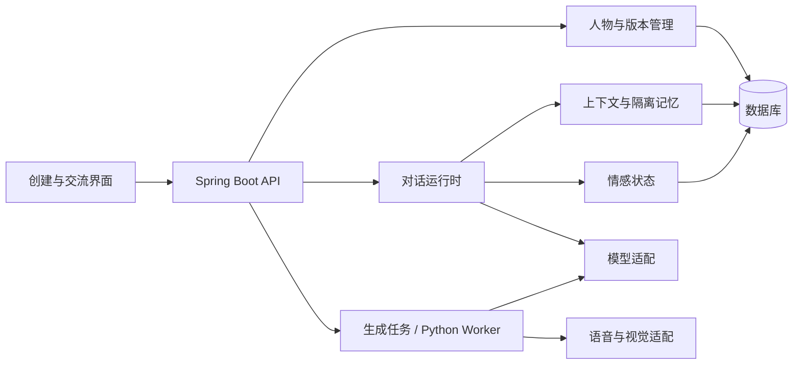

# 虚拟人生成平台架构

当前开发入口：[实施总纲](PROJECT_BLUEPRINT.md) · [统一设计与交互](DESIGN_SYSTEM.md) · [2026-10-08 审查](PROJECT_REVIEW_2026-10-08.md)。

日期：2026-10-04。状态：文字人格、记忆、情感对话与多媒体适配已实现，本地验收见 PERSONA_VERIFICATION.md；现有 API 与表结构见 [历史工作知识架构](LEGACY_WORK_ARCHITECTURE.md)。

## 现有基线与复用范围

现有 Spring Boot API、Python Worker、静态网页、H2/PostgreSQL、任务租约和审核发布机制可作为基础。
现有 ProfileVersion 是工作知识版本，ANSWER 是知识问答；不能直接宣称它们已经支持人物、关系记忆或情感运行时。
首阶段沿用一个 API 和一个 Worker；先明确模块边界，无需立即拆为多个独立服务。

## 已实现模块

- 人物管理：人物设定、授权来源、人格版本、模板与发布指针。
- 对话运行时：固定人格版本，装配短期上下文、用户关系记忆与情感状态，生成流式回复。
- 记忆管理：候选记忆、用户确认、检索、纠正和删除；按项目、人物、用户隔离。
- 情感状态：记录情绪、强度、触发上下文及更新时间，跨轮次有连续变化；输出可供文字、声音和形象使用。
- 生成 Worker：材料分析、人格候选生成与结构校验；处理形象、语音和转写任务。
- 媒体适配：语音识别、语音合成、图像理解、形象生成协议已实现，轻量动画由浏览器驱动；真实媒体供应商仍待验证。

## 数据对象与存储

Persona / PersonaVersion：人物身份、设定、来源类型、授权材料引用、不可变版本和发布状态。
Conversation / Message：项目、人物、用户、固定人格版本、消息与运行状态。
Memory：所属项目、人物和用户、内容、来源消息或材料、时间、确认状态与删除状态。
EmotionState：会话情绪、强度、触发依据、更新时间和状态版本。
MediaAsset：后续阶段的声音、图像、形象资产及授权信息。
人物、版本、交流、消息、记忆及任务已对应persona_*表；情感状态保存于交流与回复JSON，媒体以受限data URL保存于人物、消息或私有任务结果，MediaAsset独立对象存储尚未引入。migrations/V001至V005为追加迁移，由persona_schema_version记录，保留旧工作知识数据。

## 对话与生成流程

人物创建 → 手工设定或授权材料分析 → 人格候选 → 编辑与预览 → 发布不可变版本。
用户输入 → 服务端鉴权 → 固定人格版本 → 获取隔离记忆与上下文 → 更新情感状态 → 生成回复 → 保存交互 → 提议候选记忆 → 用户确认。
人物配置与用户关系状态分开存储；共享人物发布不会携带个人对话和关系记忆。
媒体阶段通过统一的语气和情绪输出协调文本、声音及表情；延迟、失败降级与打断机制需在接入时验证。

## 实施顺序与接口边界

先完成文字人物的数据迁移、创建编辑、预览对话、记忆管理和版本发布，再扩展语音与视觉。
现有工作知识 API 保留兼容；人物、对话、记忆使用独立契约、鉴权和表结构，保留旧接口及数据语义。
现有令牌、Worker 凭证、租约、审计与模型密钥管理继续有效。对话通过Worker解析模型SSE并提交受租约保护的增量，浏览器每两秒取回；完整结果校验后写入正式消息。记忆按用户/人物检索最近30条已确认项，历史上下文最近24条。企业SSO、多媒体对象存储、向量检索和成本配额仍待实现。

## 已实现入口与协议

Spring Boot 的 persona、personality、conversation、memory、media、task 模块分别管理人物、人格资产、私有交流、记忆、媒体和任务，模块内采用 Controller / Service / Repository 分层；worker/persona.py包装固定上游提示词与媒体接口，不导入上游脚本执行人物资料中的命令。
/api/projects/{p}/personas 与 /api/personas/{id}负责目录和设定；generate、versions/{v}/revise、review、rollback、export、restore完成生命周期。
/api/personas/{id}/conversations、/api/conversations/{id}/messages以及memories、memory、speech、image、avatar负责互动与媒体。
/internal/persona-jobs/claim及heartbeat/delta/complete/fail只允许独立Worker凭证。CHAT/TTS/ASR任务仅提交者可读，负责人权限不扩大到私人关系数据。
人物管理页面为默认/，旧工作知识页面为/knowledge.html。服务仍以单API + 单Worker为本地验证基线；先备份并用单实例执行迁移，再评估扩容。

## 工作空间知识互通

人物工作室与虚拟经历台已共享登录和工作空间；人物通过独立绑定读取同空间已发布知识专题，回答保存来源。V004为追加迁移。详见[互通架构](WORKSPACE_KNOWLEDGE_ARCHITECTURE.md)。

## Spring Boot 实现结构

现有集中式接口和业务类已拆为业务模块，配置、认证、异常处理和迁移独立组织。具体目录、依赖方向和开发规则见 [Spring Boot 代码结构](SPRING_BOOT_STRUCTURE.md)。
