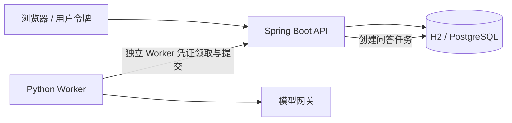

# 第一版架构与接口约定

## 技术决策

Spring Boot API + Python Worker + 单页静态前端。API 是数据与权限的唯一入口；Worker 不直接写数据库。
API 使用 JDBC，开发用 H2 文件数据库，容器试点用 PostgreSQL。第一版短文本直接保存数据库，避免数据库与对象存储双写；超过本版容量后引入对象存储适配器。
任务队列使用数据库租约，领取采用条件更新；任务完成通过租约 token 与状态进行幂等检查。
不依赖 Redis 或浏览器进程。模型推理由公司的 HTTP 模型网关提供，采用 Chat Completions 兼容协议；配置模型地址、名称、密钥和超时。

## 数据对象

- User：身份与令牌哈希；ProjectMember：项目、用户、角色。
- Material：项目、文件名、正文、摘要 hash、作者、创建时间。
- Profile：项目、标题、published_version_id。
- ProfileVersion：Profile、不可变内容 JSON、Work Markdown、基础发布版本、候选/批准/拒绝状态、审核记录、来源 ID 集合。
- Job：DISTILL / ANSWER；project/profile、输入快照、基础版本、状态、租约 token、租约截止、尝试次数、结果、错误、创建人。
- Audit：项目、操作者、动作、资源、时间。无原材料或密钥正文。

## 状态与并发

Job：QUEUED → RUNNING → SUCCEEDED / FAILED；租约到期重新领取，超过最大 attempt 转 FAILED。人工 retry 只对 FAILED 生效。
Version：CANDIDATE → APPROVED / REJECTED。发布时检查当前指针等于候选 base_version；否则 409，需重新蒸馏。
批准历史版本可用于回滚；下载和问答只使用固定已批准版本。问答任务固定版本，不随之后发布变化。

## Worker 分析与验证

材料按字符分块，标记 material_id/chunk_id。分块模型返回 claims JSON；逐条校验章节、长度、证据 ID 和原文引用，去重后与基础版本知识合并。
Work-only Markdown 由经过验证的 claims 渲染，带引用标识；不将模型生成的任意 frontmatter 或工具指令作为产物执行。
第一版追加只新增去重后的条目，不自动改写已有事实。冲突由审核者拒绝或退回补充材料；结构化 replace/retire 后续扩展。
模型调用不携带任何本机宿主的账号、会话或文件路径。

## 接口分组

- /api/me、/api/projects、/api/projects/{id}/members
- /api/projects/{id}/materials：上传与列表（OWNER/EDITOR）
- /api/projects/{id}/profiles：目录，按角色过滤候选信息
- /api/profiles/{id}/distill：提交材料 ID 集合
- /api/profiles/{id}/versions、/api/versions/{id}/review、/api/profiles/{id}/rollback
- /api/profiles/{id}/download、/api/profiles/{id}/questions
- /api/jobs/{id}、/api/jobs/{id}/retry、/api/projects/{id}/audit
- /internal/jobs/claim、/internal/jobs/{id}/complete、/internal/jobs/{id}/fail：独立 Worker 权限

Worker 用短租约与超时受控模型调用，领取结果包含任务所需的最小数据。用户 API 返回 401/403/404/409/422 等明确错误，不返回内部异常或凭证。

## 部署边界

平台代码位于独立 distilly-platform 仓库的 server/、worker/；上游开源创建器位于同级 distilly 仓库。平台仅复用 vendor 中固定版本的工作分析提示词。Spring Boot 3.5 / Java 17+，Python 3.11+。
容器配置采用 API、Worker、PostgreSQL 三服务；只暴露 API 端口。测试模式必须显式启用；真实模型模式缺少配置时启动失败。
试点采用单 API、单 Worker，先以两个任务并发以下验证；水平扩容通过租约和数据库事务保障。
企业接入前需配置 HTTPS、个人令牌或 SSO、数据库备份与网关；没有企业连接信息时不宣称已完成这些验证。

参考：[Spring Boot 3.5 系统要求](https://docs.spring.io/spring-boot/3.5/system-requirements.html)。
