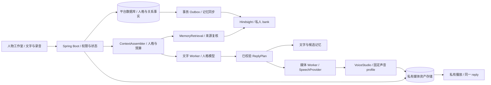

# Hindsight 与 VoiceStudio 接入虚拟人平台方案

日期：2026-10-10。目标项目：`distilly-platform`。状态：**调研与设计完成，接入代码、迁移、部署及真实效果均待实现和验收**。

本方案承接 [实施总纲](PROJECT_BLUEPRINT.md) 中的相关记忆检索、上下文预算、人物专属声音、统一回复计划与任务调度。研究依据是用户指定的两个仓库及本项目当前源码，不以开源项目的宣传或协议示例作为平台验收结果。

## 1. 采用决策

| 项目 | 在虚拟人中的职责 | 接入方式 | 第一阶段范围 |
|---|---|---|---|
| Distilly / 本平台 | 稳定人格、来源、版本、发布、对话和权限 | 保留 Spring Boot 模块化单体与 Python Worker | 保持现有业务权威 |
| Hindsight | 从长期关系事实中找相关记忆；后续形成有依据的关系理解 | 独立自托管服务，通过固定版本 REST 契约调用 | 只索引用户已确认记忆；先用 recall，后用 reflect |
| VoiceStudio | 人物专属音色、授权声音克隆、TTS 与 ASR | 独立 headless Python 后端，通过 HTTP 接入 | 已完成文字回复的语音合成、录音转写、声音版本 |

推荐组合：**Distilly 定义“我是谁”，Hindsight 帮助找回“我们共同确认过什么”，VoiceStudio 决定“这段已生成的话怎样说出来”**。本平台负责最终回复与情绪，不让记忆总结或语音模型自行改写人格。

先完成可回退的文字记忆增强，再做人物声音和按轮语音交流；实时双向语音、离线口播视频和实时数字人分别设验收门槛。VoiceStudio 的视频配音能力不能直接当作人物形象或实时口型驱动。

## 2. 调研基线与适配差异

公开仓库 `main` 在研究时解析为以下提交；后续实现应固定提交、依赖锁和镜像 digest，升级重新检查契约。两仓库 README 分别指向 `vectorize-io/hindsight` 和 `debpalash/VoiceStudio` 上游，本轮以用户指定 fork 的固定提交为研究依据。

| 仓库 | 固定研究提交 | 阅读重点 |
|---|---|---|
| [heroLi/hindsight](https://github.com/heroLi/hindsight) | `44d5340148fd47efb34e184d61f87ab5e2d8d1e2` | Core Concepts、OpenAPI、文档替换/删除、observation 失效、mental models |
| [heroLi/VoiceStudio](https://github.com/heroLi/VoiceStudio) | `06c6e077f0fc35149efefc3561e9be5ae835d916` | 中文 README、speech platform、OpenAI 兼容音频、声音 profiles、引擎与许可 |

检索到的固定版本文件与 SHA-256 记录在 [研究来源清单](research/hindsight-voicestudio-2026-10-10.json)。它不是已安装依赖清单，也不修改 `vendor/distilly/UPSTREAM.json`。

### Hindsight

- `retain` 使用模型抽取事实、时间、实体及关系；`recall` 融合语义、关键词、图及时间检索；`reflect` 进一步形成有依据的理解。后两者不能替代平台的权限和事实审核。[Core Concepts](https://github.com/heroLi/hindsight/blob/44d5340148fd47efb34e184d61f87ab5e2d8d1e2/README.md#core-concepts)
- `world`、`experience` 是上游事实路径，`observation` 是归纳结果，mental model 是长期维护的问答摘要。它们与平台的“共享知识 / 人物经历 / 私人记忆 / 人格”不是一一对应的业务表。原创经历需要标明虚构来源；模型归纳不能升级为已确认事实。
- 同一个 `document_id` 可用 `update_mode=replace` 重建内容；异步 retain 支持客户端 `operation_id` 去重。`recall` 返回 `document_id`、metadata、来源等信息，适合映射回平台记忆。[OpenAPI](https://github.com/heroLi/hindsight/blob/44d5340148fd47efb34e184d61f87ab5e2d8d1e2/skills/hindsight-docs/references/openapi.json)
- 默认 tags 匹配可能包含无标签数据；不以标签代替权限。即便使用严格匹配，也要由平台选择 bank 并复核结果。[检索契约](https://github.com/heroLi/hindsight/blob/44d5340148fd47efb34e184d61f87ab5e2d8d1e2/skills/hindsight-docs/references/developer/api/recall.md)
- 文档删除会清理源记忆，并使相关 observations 失效、重归纳；本轮未运行并发删除、晚到写入及 mental model 更新验证，所以平台仍需独立的版本屏障和失效机制。[文档管理](https://github.com/heroLi/hindsight/blob/44d5340148fd47efb34e184d61f87ab5e2d8d1e2/skills/hindsight-docs/references/developer/api/documents.md)、[Observation 生命周期](https://github.com/heroLi/hindsight/blob/44d5340148fd47efb34e184d61f87ab5e2d8d1e2/skills/hindsight-docs/references/developer/observations.md)

### VoiceStudio

- 可用 headless Python 后端，不要求把 Electron 桌面端嵌进平台。TTS 为 `POST /v1/audio/speech`，ASR 为 `POST /v1/audio/transcriptions`；另有流式 ASR 与 TTS 通道。[本地语音服务](https://github.com/heroLi/VoiceStudio/blob/06c6e077f0fc35149efefc3561e9be5ae835d916/docs/speech-platform.md)
- TTS 单次 `input` 最多 4096 字符，`voice` 支持 profile ID、名称或预设；`alloy` 等兼容名称映射到引擎默认声音，不能用于固定某个人物的克隆音色。`instructions`、`language` 等扩展的实际效果依引擎而异。[TTS 请求源码](https://github.com/heroLi/VoiceStudio/blob/06c6e077f0fc35149efefc3561e9be5ae835d916/backend/api/routers/openai_compat.py#L243)
- `POST /profiles` 中 `kind=clone` 需要 `ref_audio`，`kind=design` 需要结构化 `vd_states`；声音设计不是所有引擎都能接收一段任意描述。profile 与授权录音分别有接口；授权记录本身不证明人物身份。[声音 profile 源码](https://github.com/heroLi/VoiceStudio/blob/06c6e077f0fc35149efefc3561e9be5ae835d916/backend/api/routers/profiles.py#L120)
- `/.well-known/voicestudio-speech` 主要声明 ASR/MCP 协议，不提供某 TTS 引擎已下载、可运行或中文效果达标的保证；TTS 需结合 `/engines/tts`、音色映射和实际探测判断。[能力发现源码](https://github.com/heroLi/VoiceStudio/blob/06c6e077f0fc35149efefc3561e9be5ae835d916/backend/api/routers/speech_platform.py)、[引擎入口](https://github.com/heroLi/VoiceStudio/blob/06c6e077f0fc35149efefc3561e9be5ae835d916/backend/api/routers/engines.py)
- 流式 TTS 存在 `/ws/tts`；当前源码按句合成后发送 PCM，不能据此保证逐 token 合成或实时性能。普通兼容 TTS 也提供音频/SSE 输出选项，均需单独测首音频延迟。[流式源码](https://github.com/heroLi/VoiceStudio/blob/06c6e077f0fc35149efefc3561e9be5ae835d916/backend/api/routers/tts_stream.py)

## 3. 当前平台可以复用的部分

| 当前证据 | 可以复用 | 需要补齐 |
|---|---|---|
| `MemoryService.memory/forget` | 候选确认、纠正、拒绝、删除，取消在途旧记忆聊天 | memory revision、外部同步、关系摘要失效 |
| `PersonaTaskRepository.findConfirmedMemories` | 按人物、用户只选 CONFIRMED 项 | 当前最近 30 条改为相关性检索及来源复核 |
| `PersonaTaskRepository.findRecentMessages` | 最近 24 条历史，本轮输入单独传递 | token 预算、会话摘要、源消息删除后的失效 |
| `PersonaTaskService.claim/complete` | 固定会话人格版本、租约、结果校验与幂等完成 | ContextAssembler、ReplyPlan、memory revision 屏障 |
| `MediaService.media` 与 `worker/persona.py:speech` | 私有 TTS/ASR 任务、HTTP 协议、错误处理 | 每人物音色、回复关联、长文本分段、资产存储 |
| `worker/worker.py:Worker.run` | 已有耗时任务 Worker | 串行队列需拆聊天、媒体、记忆同步执行通道 |
| 浏览器语音和轻量形象 | 播放、停止、文字降级和简单动画 | 统一 reply 打断与播放游标；后续真实视频另接驱动 |

当前 TTS 使用全局 `TTS_VOICE`，输入允许 12000 字符、音频返回约 1 MiB data URL；直接换 VoiceStudio 地址会遇到长度、音色、冷启动和产物大小等差异。当前前端每两秒轮询文字增量，尚未建立端到端音频流。

## 4. 目标架构与职责



平台数据库是业务权威：确认状态、用户归属、人格版本、授权、记忆修订和回复状态只由平台决定。Hindsight 是可重建的衍生索引；VoiceStudio 是语音执行器，保有其私有运行数据和模型缓存。

调用地址、凭证、模型和引擎来自服务端配置；材料、用户输入及模型输出不能选择 URL、bank 或任意文件路径。浏览器只访问平台入口，避免直接获得上游凭证或开放本机语音服务。MCP 可保留供独立工具使用，第一阶段业务链采用确定性的 HTTP 接口。

不采用 Hindsight 自动采集 wrapper 或 coding-agent ingestion：平台只显式提交自己的已确认关系事实，不采集私聊、其他 Agent 历史或宿主 Codex sessions。

## 5. Hindsight：关系记忆接入

### 5.1 隔离与内容范围

私人 bank 按 `(project_id, persona_id, user_id, generation)` 建立，bank ID 由服务端产生的不可猜映射管理；不接受客户端指定 bank。相同人格绑定到两个虚拟人时，私人关系 bank 仍分开；共享人物的其他用户及项目负责人不因此取得关系数据。

第一阶段只导出 `CONFIRMED` 的关系记忆正文、来源标识及必要时间，不导出整段聊天、材料正文、未确认候选或拒绝项。平台须明确显示“外部记忆增强”是否启用及处理位置；自托管 Hindsight 的 LLM、embedding、reranker 也可能远程调用，需要记录实际 provider 数据流。默认先关闭，通过工作空间配置和用户启用后开始同步。

人物经历后续可独立使用 `(project, persona, persona_version)` bank，并保留原创/授权标记；第一阶段留在平台数据库。共享知识继续由 `PersonaKnowledgeService` 检索并带已发布版本引用，不混入私人 bank，也不以用户关系记忆代替 PersonaVersion。

### 5.2 写入、检索与兜底

确认记忆时，同一事务写入本地修订、关系 scope revision 和 Outbox。确认 HTTP 成功代表本地保存成功，不代表外部 retain 已完成；同步有独立状态。对历史记忆的回填只包含当前用户选择启用的 scope 中仍有效的确认项。

Outbox consumer 按 scope 串行，发送 `document_id=memory/{memory_id}/revision/{revision}`、`update_mode=replace`，metadata 带本地 ID、revision、origin 与 source ID；时间未知不伪造。异步请求使用稳定 UUID `operation_id`，收到回执后继续追踪 operation 成功，才标记 INDEXED。超时重试沿用同一 operation ID；外部失败不撤销本地确认。

```json
{
  "async": true,
  "operation_id": "<Outbox 事件的稳定 UUID>",
  "items": [{
    "content": "<用户确认的关系事实>",
    "document_id": "memory/<id>/revision/<revision>",
    "update_mode": "replace",
    "metadata": {"memory_id": "<id>", "revision": "<revision>", "origin": "interaction"}
  }]
}
```

此 JSON 是按固定 OpenAPI 设计的请求模板，尚未调用验证。不能把 `async` 的排队成功解释为索引就绪。

每轮检索步骤：

1. 平台鉴权并冻结 `persona_version`、`scope_revision`、`bank_generation` 和本轮输入；关闭记忆时不发 recall，也不装配长期记忆或关系摘要。
2. `MemoryRetrieval` 向服务端选定 bank recall，第一阶段 `types=[world, experience]`，设独立 token 上限。返回结果只用于候选排序。
3. 对每个候选的 document/metadata 映射回本地，检查用户、人物、工作空间、CONFIRMED、revision 及 generation；丢弃无完整映射、删除、拒绝或旧修订项。
4. 交给模型的是重新读取的本地确认正文及来源，而不是 Hindsight 新抽取的表述；去重后按预算保留。空结果、超时或同步滞后时，从本地有效确认记忆做关键词排序，必要时补近期项。
5. 完成回复前再检查 scope revision、会话记忆开关、人物与知识权限及租约；变化时拒绝旧结果并要求重新生成。外部 HTTP 不放在数据库行锁事务内，采用准备快照 → 外部检索 → 短事务复核。

上下文装配保留系统约束与固定人格，再按预算分配当前输入、近期消息、会话摘要、关系记忆和知识来源。模型上下文窗口是硬上限，扣除输出预算；先裁去低相关项，不能为了凑长度删掉身份/边界规则。未知模型窗口须配置，不能只按“24条”假定安全。

### 5.3 纠正、删除及晚到任务

第一版采用保守的 bank generation 策略：纠正、删除、拒绝曾同步的记忆或删除其源交流时，在本地事务里提高 scope revision、撤销旧摘要/缓存、取消受影响回复，并使旧 generation **立即不可读写于业务链**。用户数据源表保留现有删除语义；另存不含正文的 tombstone 和同步记录用于清理。

新 generation 只从剩余有效确认事实重建；尚未就绪时回退本地检索。Outbox consumer 在发送前与结果落地前检查 generation；已经发出的旧请求不能假设被中止，晚到 retain 最多写入旧 bank，不能使它重新成为活动 bank。确认在旧任务处理期间发生时，要么序列化切换，要么回填新 generation，防止丢失新事实。

退休 bank 记录 `CLEANUP_PENDING`，等外部在途 operation 终止后删除 document/bank，并核对清理结果；删除失败继续受限重试与告警，不标记已清理。这样区分“已不再用于回答”与“外部存储清理完成”。历史聊天和备份按原保留规则处理，记忆删除不会自动抹掉既有消息；若用户要撤回聊天内容，走删除交流入口。

代价是每次纠正/删除可能重建关系 bank，增加成本。等真实集成证明来源级 invalidation、并发 retain/delete 和所有衍生摘要的清理可靠后，才考虑局部更新优化。

### 5.4 Reflect、observations 与关系理解

第二阶段只对已确认事实生成私人关系摘要，如“用户偏好的回应方式”“共同讨论过的主题”。异步触发，不在每轮聊天调用 reflect；按变更合并、配额与冷却时间限制费用。

第一版不开自动持久化 mental model，先保存平台 `RelationshipSnapshot`，带 `scope_revision`、事实 ID/revision 集、生成时间、有效状态及推断标记。启用 observations/reflect 前，必须能拿到完整来源，映射并复核所有依据；来源截断、未知、已删或修订不一致时整段摘要不可用于回答。摘要不能创建确认记忆、自动改人格、发布知识或推断真实心理状态。

后续 mental model 仅作为同 generation 内的可重建缓存。bank disposition 只用于摘要推理，不能成为另一份人物性格配置；人格升级不会带动关系事实改写，摘要若依赖人格风格则按版本重新生成。

## 6. VoiceStudio：声音与语音接入

### 6.1 声音资产和发布

新增 `VoiceProfile` 与不可变 `VoiceProfileVersion`。支持预设声音、原创声音设计和授权声音克隆。流程为选择方式 → 上传/录制参考与核对转写 → 检查授权和实际引擎 → 固定文本试听 → 人工发布声音版本 → 绑定人物。

参考音频长短、格式和语言由选定引擎决定；以能力表及检查器展示条件，不硬编码成所有引擎相同的“几秒克隆”。参考转写固定保存，避免每次生成重复 ASR。真实人物材料建模授权不自动包含声音克隆授权；记录声音主体、用途、范围、凭据、期限与撤销状态。

每个发布声音版本使用新的外部 profile ID，保存参考资产 checksum、转写、引擎/模型版本、语言和风格映射，不共享可被编辑的外部名称。平台 API 禁止改已发布版本；外部 profile 本身可变，所以运行前检查已登记的指纹/配置漂移，异常时停用并生成新候选。上游 `/lock` 只用于其特定声音稳定流程，不视为全部配置的不可变保障。

用新增 `PersonaRuntimeVersion` 组合现有 `persona_version_id`、`voice_profile_version_id` 与后续形象版本；现有不可变人格版本不重写。新交流固定 runtime version，历史交流保留原绑定。旧交流没有 runtime version 时，默认继续原浏览器/旧语音策略，由用户明确选择新声音；不能悄悄跟随人物发布指针。

授权撤销具有即时效果：禁止新生成、取消在途媒体、拒绝晚到结果，并阻止受该授权约束的音频继续通过平台播放；历史配置快照仍保留来源标识。已经下载到用户设备的副本不能由平台远程删除。

### 6.2 SpeechProvider 契约

保留原 `operation=TTS/ASR` 接口。新增 `SpeechProvider`，实现旧兼容网关与 VoiceStudio adapter；供应商变更只改服务端配置和人物声音绑定，浏览器不识别外部 profile ID。

VoiceStudio adapter 使用 `/v1` 基址调用合成/转写，根地址调用 profiles 和能力入口；分别管理地址拼接，避免出现 `/v1/profiles` 或 `/v1/v1/audio/speech`。上线实现新增端点级 HTTP 白名单；同机仅允许指定回环端口，跨容器用固定内网 service，远程必须 HTTPS/WSS。不能为所有模型供应商全局打开 `MODEL_ALLOW_HTTP`。

```json
{
  "model": "<冻结的引擎 ID>",
  "input": "<本次已完成回复的 spoken_text 分段>",
  "voice": "<当前声音版本的独立 profile ID>",
  "language": "zh",
  "response_format": "mp3",
  "speed": 1.0,
  "instructions": "<平台映射、引擎支持的表达指令>"
}
```

长度超过 4096 字符时按语义句界限分段，段编号与文本范围固定；不切断数字、英文词或专名。通常聊天回复宜更短。压缩格式需检查转码依赖，不能把 ffmpeg 不可用后的 PCM 冒充 mp3。

语速、停顿与表达强度由 `emotion/style → VoiceStyleMapper` 确定性映射并限幅；仅发送该引擎验证支持的字段。中文 TTS、声音设计、克隆、情感控制、流式输出各自独立报告状态，不能因 API 可访问就宣称全部可用。

### 6.3 与文字共用回复、播放和打断

按 [实施总纲](PROJECT_BLUEPRINT.md) 增加 `ReplyPlan v1`：

```text
reply_id / conversation_id / persona_version_id / runtime_version_id
voice_profile_version_id / memory_scope_revision / answer / spoken_text
emotion / style / knowledge_citations / memory_refs / state
```

`answer` 保存现有文字契约；`spoken_text` 通过确定性文本处理去 Markdown 和链接标记，保留文字含义，不能另让 TTS/LLM 重写。知识引用与记忆来源分开，保留原 citations 字段。发送音频的是已校验、已完成的回复；用户手工输入的试听文本保持独立任务。

首版状态拆为 `text_state` 和 `audio_state`：文字完成即可展示，音频继续排队/生成；音频失败保留文字并允许重试。回复取消时停止播放、清空后续音频队列、停止轻量动画并取消媒体任务；用 reply 状态、授权版本和租约拒绝供应商晚到结果。

合成产物写入私有 `MediaAsset` 存储，返回平台资产 ID；播放器经用户权限校验获取音频，支持范围请求或分段播放。产物按 scope、reply、声音版本、分段、checksum 关联，只有同私有 scope 才可复用缓存；原始文本不能进入缓存 key 的公开字段。用户输入音频、参考录音、授权证据和生成音频分开设置留存周期及清理状态。

首版先用完整音频按轮播放，复用现有轮询任务状态；完成资产存储后再建设文本 SSE / 音频事件。低延迟版的 `audio.chunk` 包含 reply、segment、sequence、采样率/格式和时间，不能重用未知格式拼接裸 PCM。只有定义逐段最终校验、可播放缓冲、背压、断线恢复和取消后，才启用边生成边播放。

### 6.4 语音输入及后续实时交流

首版录音由用户主动开启；音频经平台 ASR 任务发到 VoiceStudio，识别文本进入可编辑输入框，核对后主动发送。平台不调用桌面全局听写、不控制系统其他输入框，也不借后台服务开启麦克风。

下一阶段通过平台鉴权中继接入 `/v1/audio/transcriptions/stream`：只显示 partial；去重 utterance，按 authoritative summary 或明确分段提交策略形成一次用户消息。需定义 VAD、回声消除、用户插话、丢帧/超时和录音结束，不把每个 partial 都送去生成回复。浏览器凭证与票据的处理按部署边界设计，长期密钥只在服务端。

## 7. 新模型、模块和接口（均待实现）

迁移使用开发时下一个未占用 `Vxxx`；先检查当时迁移列表，不能预占 V006 或修改 V001～V005。H2/PostgreSQL 升级都需验收。

| 数据对象 | 关键字段与用途 |
|---|---|
| MemoryRevision / tombstone | memory ID、revision、confirm/reject/delete、source、更新时间；删除同步记录不保留正文 |
| MemoryScope | project/persona/user、scope_revision、活动 bank generation、启用开关 |
| MemoryIndexBinding / Outbox | 外部 document、operation、generation、同步状态、重试与错误分类 |
| RelationshipSnapshot | 私有 scope、revision、来源集、摘要、推断标记、有效性 |
| VoiceProfile / VoiceProfileVersion | 独立声音资产、不可变外部 profile 与模型引用、参考 checksum、style_map |
| VoiceAuthorization | 主体、用途、证据资产、有效期、撤销状态；最小化收集身份数据 |
| PersonaRuntimeVersion | 固定人格、声音与后续形象的组合；独立于人格内容发布 |
| MediaAsset | scope、owner、类型、storage_key、大小、时长、checksum、授权与清理状态 |
| Reply / ReplyMedia | 会话、版本、scope_revision、文字/媒体状态与取消、分段、任务及资产引用 |

落位：

- `modules/memory`：业务 revision、Outbox、`MemoryRetrieval`、`RelationshipService`；外部适配放 infrastructure，不能依赖 Controller。
- `modules/conversation`：`ContextAssembler`、`ReplyPlan`、运行版本固定与回复状态。
- `modules/media`：`VoiceProfileService`、授权、`VoiceStyleMapper`、`MediaAssetService`；provider 在 Python Worker 侧实现。
- `modules/task`：在现有租约/幂等机制上增加 kind/capability 分发、取消关联和结果 revision 复核；同步 consumer 与聊天/媒体分别调度。
- `static`：在既有“交流与记忆”“声音与形象”内加功能，复用 `design-system.css`、原生 dialog 和当前会话状态。

| 拟增平台入口 | 行为与权限 |
|---|---|
| `GET /api/personas/{id}/capabilities` | 聚合 Worker 实际能力、声音绑定、依赖与最近探测状态；不泄露凭证/外部文件路径 |
| `GET /api/personas/{id}/memories/page` | 当前用户的搜索、状态筛选与分页；负责人不能查询他人私人记忆 |
| `PUT /api/personas/{id}/memory-provider` | 当前用户启用/停用增强，停用仍取消依赖该 scope 的在途回复；独立清理入口 |
| `GET /api/personas/{id}/relationship` | 当前用户可核对来源的关系摘要，不能作为公开人物资料导出 |
| `POST /api/personas/{id}/voice-profiles` | EDITOR 创建声音候选及授权资料，返回资产引用和校验状态 |
| `POST /api/voice-profiles/{id}/preview` | 有访问权者试听固定文本；preview_audio 不自动发布 |
| `POST /api/voice-profiles/{id}/publish` | OWNER 发布有效声音候选；版本不可变 |
| `PUT /api/personas/{id}/voice-binding` | OWNER 绑定已发布声音，生成新 runtime version，仅新交流采用 |
| `POST /api/replies/{id}/speech` | 当前交流所有者合成已完成回复，服务端读取固定版本和文本，拒绝任意越权版本 |
| `POST /api/replies/{id}/cancel` | 当前交流所有者打断；幂等更新回复与关联媒体任务 |
| `GET /api/media-assets/{id}/content` | 私有读取、范围请求与撤销复核；参考/授权资产和私人回复分别鉴权 |

原 `/speech`、`/memories`、`answer/emotion/citations` 与旧 data URL 回读保持兼容；新增声音发布不可绕过已存在的角色规则。

## 8. 用户界面

“交流与记忆”：保留消息时间线；每次回答可展开“本次使用的记忆”查看本地正文和源消息。关系记忆管理采用搜索/状态筛选、表格、分页；确认、纠正和删除在原生弹窗操作。关系摘要单独标记“基于已确认记忆的推断”，有来源与刷新时间。显示“已保存 / 同步中 / 暂用本地检索”，避免用户把外部服务失败理解为记忆丢失。

“声音与形象”：声音列表展示名称、方式、语言、状态、版本和当前绑定。新增声音通过向导弹窗完成录音、授权、参考转写和试听；详情可以核对来源与使用范围。用户看“可试听 / 模型准备中 / 当前设备不可用 / 授权已撤销”，配置变量和工程错误码留给管理员接入文档。

交流页有播放、停止和转写核对入口。音频生成中可以继续阅读文字；文字失败不能生成无依据的语音。390px 小屏、键盘焦点、Esc、录音中提示与减少动画都按 [设计规范](DESIGN_SYSTEM.md) 验收。

## 9. 部署、运行与选型门槛

| 部件 | 本地设计 | 容器/试运行设计 |
|---|---|---|
| 平台 API / 页面 | 保持 `127.0.0.1:18080` | 对外仍通过平台 HTTPS 入口 |
| 平台 Worker | 聊天、媒体、记忆同步能力分别分发 | 独立凭证、租约及每 provider 并发限制 |
| Hindsight | API 参考 8888；管理 UI 参考 9999；先检查端口占用 | 固定镜像，自用 PostgreSQL/pgvector 数据库、备份和权限，不接管平台业务表 |
| VoiceStudio | headless API 参考 `127.0.0.1:3900` | 单独语音运行环境/必要 GPU；只开放给平台服务 |
| 媒体资产 | 私有目录位于既有忽略数据范围 | 私有对象存储；平台控制读取与清理 |

8888/9999/3900 是上游常见端口与设计候选，不是本轮已启动的服务；占用时明确规划，人物工作室入口始终保持 18080。不使用 `latest` 自动升级。新增配置统一由 `PlatformProperties`/Worker 配置读取，拟定 `MEMORY_PROVIDER`、`HINDSIGHT_BASE_URL`、`HINDSIGHT_API_KEY`、`SPEECH_PROVIDER`、`VOICESTUDIO_BASE_URL`、`VOICESTUDIO_API_KEY` 与 provider 限额，待实施时才加入 `.env.example`。

Hindsight 的 retain/reflect 需要模型推理，embedding/reranker 需要资源；VoiceStudio 的延迟受引擎、硬件、首次加载和参考录音影响。本轮未探测目标硬件，也未下载模型。先做中文固定样本的候选引擎对比，记录内存/显存、冷/热启动、首音频、RTF、清晰度、音色一致性和许可；达到门槛后固定一款 TTS 和一款中文 ASR。CPU 可运行不等于实时可用，多语言目录规模不等于中文质量达标。[引擎指南](https://github.com/heroLi/VoiceStudio/blob/06c6e077f0fc35149efefc3561e9be5ae835d916/docs/engines/README.md)、[性能指南](https://github.com/heroLi/VoiceStudio/blob/06c6e077f0fc35149efefc3561e9be5ae835d916/docs/performance.md)

许可记录：Hindsight 仓库 MIT；VoiceStudio 应用及 backend 为 AGPL-3.0-only，其修改、网络提供和分发方式需要在选型时核对相应义务。独立 HTTP 进程是技术边界，不是许可豁免结论。VoiceStudio 的 LICENSE-NOTICE 单独指出默认 OmniVoice 权重 CC-BY-NC，tokenizer 等还有独立条款；正式商用先核对所选模型权重、依赖和分发模式，不能用“开源”或应用商业许可覆盖所有模型权利。[Hindsight LICENSE](https://github.com/heroLi/hindsight/blob/44d5340148fd47efb34e184d61f87ab5e2d8d1e2/LICENSE)、[VoiceStudio 许可说明](https://github.com/heroLi/VoiceStudio/blob/06c6e077f0fc35149efefc3561e9be5ae835d916/LICENSE-NOTICE.md)

指标不记录材料、录音正文和凭证。观察记忆检索/回退、同步滞后、删除清理积压、候选被拒原因、token 成本、队列耗时、文字首字、音频首段、完整回复、取消晚到和 provider 错误；保留 scope 的不可逆关联标识用于排错。

## 10. 实施任务与验收

以下为建议任务顺序，工作量在真实 PoC 后估算；本次只交付方案。

| 顺序 | 可独立评审的交付 | 退出门槛 |
|---|---|---|
| A：文字底座 | memory revision、scope、ContextAssembler、token 预算、本地相关性兜底、任务能力调度 | 历史兼容，长对话不超预算，删除/关闭取消旧任务 |
| B：Hindsight recall | 固定服务 PoC、bank 映射、Outbox/operation 追踪、回填、来源复核、bank rotation | 越权、已删、旧修订命中进入模型为 0；上游不可用文字仍可用 |
| C：关系理解 | reflect 来源链、RelationshipSnapshot、修订失效、关系详情 | 归纳明确为推断，无来源/截断摘要拒绝使用，不自动改人格 |
| D：语音底座 | 私有 MediaAsset、授权对象、VoiceProfileVersion、runtime 绑定、实际能力发现 | 中文真实样本可试听、每人物音色固定、旧交流固定、撤销立即停用 |
| E：语音回复 | ReplyPlan、4096 字符分段、SpeechProvider、已完成 reply 合成与统一打断 | 文字/声音含义一致、媒体失败保留文字、晚到不播放、两用户隔离 |
| F：实时语音 | 平台 ASR 中继、VAD/AEC、事件流、音频背压与断线恢复 | 实际设备插话、回声与延迟测量达标；达标前维持按轮语音 |
| G：视频与运营 | 另选形象驱动、音视频同步、配额、正式身份、清理与恢复 | 使用同一 reply/音频，生产数据库/备份与实际设备单独验收 |

测试集与建议目标：

- 记忆：每 scope 至少 200 条已确认事实，包含早期偏好、同名人物、时间变化和冲突；不少于 30 个固定检索问题。拟定相关事实 Recall@5 ≥90%，比较当前最近 30 条、本地检索和 Hindsight 的结果/延迟/成本；目标尚未测得。
- 隔离：同人物不同用户、同用户不同人物/空间、相同人格多绑定、负责人查看他人记忆、伪造 bank/document、无标签/未知来源返回；越权进入上下文 0 次。
- 失效：确认/纠正/拒绝/删除/关闭、删除源交流、上游超时重试、operation 晚到、摘要依据截断、bank 重建期间新确认；旧正文进入新上下文 0 次。已有历史聊天残留按消息保留语义单独核对。
- 人格：沿用总纲 3 类人物 ×10 情境评测，记忆增强不能降低身份一致性或把共享知识变亲身经历。
- 声音：不少于 20 句中文/数字/专名/中英混合样本、6 类情绪映射；录音清晰度和音色一致性人工平均 ≥4/5 为拟定目标。报告冷启动与热启动 p50/p95、RTF 和失败率，不能只记一次最快值。
- 延迟：初步 PoC 目标 recall p95 ≤800ms（超时回退）、热启动首音频 p95 ≤3s；分别测量排队、合成首段和“用户输入结束至开始播放”的整体时间。达不到实时门槛时保留按轮语音，不用流式接口存在代替性能验收。
- 媒体：超过 4096 字符、超过旧 1 MiB、转码缺失、profile 漂移、跨用户缓存、授权撤销、取消后晚到、重试重复音频、ASR partial/summary 去重、录音权限拒绝与产物清理。
- 集成：相关 Java/Worker/UI 回归及 `python3 scripts/verify.py --e2e`；协议 mock 与真实供应商分开记录。PoC 先用合成关系材料、原创声音或明确授权样本，Docker/PostgreSQL、真实音质与实际麦克风另作验收。

## 11. 本次完成与后续待办

已完成：固定两个 fork 的研究版本，核对公开 README、相关 API/源码、删除语义、运行条件和许可说明；对照本平台模块与源码制定接入职责、数据模型、同步/失效、声音版本、权限、接口、页面、部署和分阶段验收。

本次未实现接入代码、未变更数据库或运行配置、未安装第三方应用/skills、未下载模型、未启动 Hindsight/VoiceStudio，也未进行真实效果测试。下一张开发任务建议从 A+B 开始，把长期相关记忆和可靠删除做成可切换的文字闭环，再推进 D+E 的人物声音。
