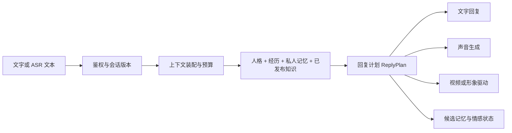

# 虚拟人平台实施总纲

更新：2026-10-12（文字上下文第一批实现；其余阶段仍按原验收边界）。范围：`distilly-platform`，以当前源码和本轮验证为基线。本文是后续开发入口；标注“待实现”的设计不代表已经交付。

2026-10-21 续做：用户将模型收费工作后置，继续无密钥文字功能。已补齐人格库绑定目标确认、丢失响应只读核对、幂等绑定及返回目标人物聊天，见 [创建到首聊旅程](PERSONALITY_BINDING_JOURNEY_2026-10-21.md)。原 247 项候选未恢复；最新增量以 Git 和该阶段证据为准。真实模型出口仍关闭。

同日继续补齐 [当前聊天的中断、停止与显式重试](CHAT_RECOVERY_2026-10-21.md)，复用既有任务取消/重试接口，新增当前会话终态可见性、只读核对及页面恢复；不等价于原始消息提交幂等或真实模型质量。

2026-10-10 新增 [Hindsight 与 VoiceStudio 接入设计](HINDSIGHT_VOICESTUDIO_PLAN.md)：承接本文的相关记忆检索、上下文预算、声音版本和统一回复计划，明确外部索引与业务事实的边界、纠正/删除屏障及语音协议适配。此补充仅完成调研和方案，实施与真实验收待执行。

## 当前实施边界（2026-10-12）

用户决定先编码成熟、之后再部署；阿里云仅未来目标。当前不购买或配置云资源、不部署、不等待域名/预算。本地模型暂不安装、下载，取消原安装待审批步骤，保留可插拔设计。批次八已修复个人/Worker凭证复用与记忆纠正竞态，批次九增加跨队列用户容量与单API进程提交频率，批次十补齐文字阶段输出上限与截断拒绝，完整Java120/Worker45及两套HTTP验收通过；仍未证明语义召回、真实多媒体或生产云环境就绪。

## 产品与对象

用户应能创建人物 → 配置人格与经历 → 预览 → 发布 → 文字交流 → 确认共同记忆 → 后续接入语音和视频。
“克隆感”来自稳定身份、表达习惯、可追溯经历、关系连续性和一致的声音形象。它需要持续评测，不能由一次成功回复或一份提示词证明。

| 对象 | 保存什么 | 当前实现 / 后续边界 |
|---|---|---|
| 虚拟人 Persona | 名称、身份、背景、外观、权限与发布指针 | 已有 `persona`，独立人格以 `library` 标记复用同表；先保留兼容 |
| 人格版本 PersonaVersion | 性格、价值观、语气、表达规则、情绪触发、互动边界及来源 | 已有不可变 `persona_version`；目前主要是 Markdown + analysis JSON，结构化风格字段待增加 |
| 人物经历 | 本人授权事实或原创背景；时间、参与者、依据、来源类型 | 已有固定版本背景/授权摘录的相关筛选与来源标记；仍未建独立经历对象和时间轴 |
| 共享知识 | 工作空间已发布的事实和经验，附版本引用 | 已有；知识不能自动变成人物亲身经历 |
| 私人关系记忆 Memory | 某用户与某人物的偏好、共同经历、来源消息、确认状态 | 已有确认、纠正、删除、关闭；已按当前话题从全部已确认记忆进行词面相关检索；语义召回与评测待完善 |
| 短期上下文 | 当前会话近期消息 | 最多24条近期候选，已与记忆/经历/知识共享保守文本预算；本轮输入与固定人格不截断；摘要与精确token计数待实现 |
| 情感状态 | 当前情绪、强度、原因、上轮标签 | 已有会话与回复 JSON；是会话级表达状态，跨会话关系状态尚未独立建模 |
| 声音 / 形象版本 | 音色、语速、情绪映射、头像、形象与动作资源 | 现有浏览器和媒体网关原型；人物专属声音、授权资产版本、视频待实现 |

来源必须区分 `user_setting`（原创设定）、`authorized_source`（有依据的授权材料）、`interaction`（用户确认的交流事实）、`inference`（待核对推断）。推断不能直接进入已确认经历。

## 当前审查结论

后端模块分层、固定人格版本、用户隔离、候选记忆确认、追加迁移可继续复用。保留单 API 的模块化单体，先把文字产品和运行质量做稳。当前不需要为每个业务模块建立独立服务。

| 优先级 | 问题与影响 | 处理 |
|---|---|---|
| P1 | 构建覆盖运行中的 JAR 可导致延迟类加载失败和 HTTP 超时 | 本轮启动器和两套 E2E 均改用临时目录独立 JAR 副本，停止后清理 |
| P1 | 本轮输入同时进入 history 和 message，模型收到重复内容 | 本轮已修正；测试覆盖首次空历史与后续保留历史 |
| P1 | 单 Worker 串行执行；人格分析、图像、语音会阻塞后续聊天 | 已实现CHAT优先、等待提升与人物/知识轮流领取；仍串行，运行中长任务的执行隔离和供应商并发上限待实现；完成回调保持租约 |
| P1 | 历史按条数、记忆按最近时间截取；长对话可能超模型上下文，较早的重要偏好会掉出检索范围 | 已实现上下文装配器、保守文本预算、词面相关记忆与来源筛选；摘要、精确token计数和外部索引仍待实现，后续需同步失效 |
| P1 | 两套页面基础样式、品牌和弹窗分散，修改容易不一致 | 本轮增加共享设计系统，统一基础控件与品牌，经历台旧弹窗转为原生 dialog |
| P1 | 情感/语气效果没有固定评分集；流程通过不能证明人物像本人 | 待增加固定情境集和人工评测，作为文字版发布门槛 |
| P2 | avatar、图片、音频 data URL 存数据库 / 任务结果，查询与备份会增长 | 接入语音阶段前迁移到私有对象存储与资产元数据；历史字段只读兼容 |
| P2 | 默认 UI 跨工作室和经历台生成人格，新用户需要理解两类对象 | 已补来源人物预选、显式绑定确认、丢失响应核对及返回目标人物聊天；完整单页向导与能力状态仍待实现 |
| P2 | 未配置媒体也能提交任务后再失败；配置字段进入产品文案 | 本轮简化产品文案；服务端能力发现及准确的禁用/配置提示待实现，不能从 API 环境推断 Worker 配置 |
| P2 | 业务结果大量使用 Map、前端压缩单行函数；多人扩展可读性不足 | 新契约使用 DTO；按功能逐步拆前端模块，先迁移再删除兼容代码，不整库自动替换 |
| 上线前 | SSO、配额、生产 PostgreSQL、备份恢复与指标尚无本轮实测 | 作为试运行门槛单独验收，不把 H2 / 演示网关通过当生产完成 |

源码锚点：`modules/task/service/PersonaTaskService.java` 装配和完成回复；`modules/task/repository/PersonaTaskRepository.java` 查询历史与记忆；`worker/worker.py:Worker.run` 串行调度；`worker/persona.py:chat` 人格、记忆及情感模型协议；`modules/media/service/MediaService.java` 媒体任务。

## 代码结构与依赖

```text
server/                Spring Boot 模块化单体；权限、版本、状态与事务权威
  modules/workspace    空间、成员、授权、审计
  modules/material     材料与来源
  modules/persona      虚拟人、发布与版本
  modules/personality  可复用人格与固定版本绑定
  modules/conversation 会话和消息；后续增加上下文装配、回复事件
  modules/memory       私人记忆；后续增加检索端口和失效机制
  modules/knowledge    已发布知识及来源检索
  modules/media        媒体输入与资产授权；后续增加声音、形象版本
  modules/task         任务、租约、取消、重试、幂等完成
  static/              当前两页面；共享 design-system.css 与 platform-session.js
worker/                Python 模型调用与耗时生成；不能决定发布、权限或记忆确认
vendor/distilly/        固定来源的提示词；不直接修改上游脚本
tests/                 HTTP 端到端、UI 行为与架构约束
scripts/verify.py       本地与 CI 的统一回归入口
docs/                  总纲、结构、协议、设计规范及验收记录
```

Controller → DTO → Service → Domain / Repository。跨模块通过 Service；Controller 不依赖 Repository，不写 SQL；Domain 不依赖业务 Service、数据库或 HTTP。当前检查器执行基础源码约束，不等价于完整依赖图和运行时架构验证。

已实现 `conversation/service/ContextAssembler`、`conversation/domain/ExperienceRecall` 与 `memory/service/MemoryRetrieval`；后续按实际需求增加 `conversation/domain/ReplyPlan`、`media/service/MediaAssetService` 和 Worker provider adapters。先实现真实调用者再提取接口，避免只有空类的架构。

前端目标逐步演进为 `shared/{session,api,ui}` 与 `features/{persona,personality,conversation,memory,media,knowledge}`。当前保留静态页面与全局函数兼容，新增公共基础样式必须放共享文件。现有页面稳定后再决定是否迁移到组件框架；此次没有替换前端技术栈。

## 文字到语音、视频的共同运行链



ReplyPlan 是待实现的新增内部契约：`schema_version / reply_id / conversation_id / persona_version_id / text / emotion / style / citations / memory_candidates`。`style` 保存语气、语速、停顿与表达强度；`emotion` 保存标签、强度、原因和前状态。模型输出先校验，再由确定性的映射器决定声音与表情参数。

文字、声音、视频使用同一 `reply_id` 和人格版本；不能让三个模型独立“扮演三次”导致身份或情绪不一致。新字段采用可选兼容字段与契约版本，保留旧 `answer / emotion / citations` 响应。

后续回复事件定义为 `reply.started / text.delta / text.completed / audio.chunk / visual.state / reply.completed / reply.failed / reply.cancelled`，包含 `reply_id / sequence / timestamp`。文字阶段可采用 SSE；当前网页仍为每两秒轮询，并未实施 SSE 推送。断线从最后序号恢复，重复事件去重；完成前的增量只能作为临时展示。

打断统一取消文本后续写入、音频播放和视频驱动；供应商无法中止请求时，通过租约 / reply 状态拒绝晚到结果。媒体失败保留文字并提供重试，文字失败不能生成无依据的声音或视频。实时双向语音和视频属于下一阶段，需要独立评估传输方案和延迟，不能由离线 TTS 协议替代。

## 追加数据模型（待实现）

| 新对象 | 关键字段 | 迁移要求 |
|---|---|---|
| PersonaExperience | project、persona、version、origin、event_time、summary、source_refs、status | 从新编辑入口开始结构化；旧 background 保留，不自动声称解析出的经历是真实事实 |
| RelationshipState | persona、user、revision、summary、updated_at | 与共享人格隔离；关系变化有可解释来源，不能只凭模型打分改变关系 |
| Memory revision / index | body、source、confirmed_by、updated_at、revision、index_revision | 确认 / 纠正 / 删除同步撤销检索和摘要；禁止仅删 UI 行 |
| VoiceProfileVersion | persona、provider_ref、voice_ref、style_map、authorization_ref | 固定不可变配置；服务密钥只通过服务端引用 |
| AvatarProfileVersion | persona、asset_refs、expression_map、authorization_ref | 与声音版本共同固定到发布配置 |
| MediaAsset | scope、owner、type、storage_key、checksum、duration、status、authorization_ref | 访问经权限校验和短期地址；不在公开 URL 中泄露存储权限 |
| Reply / ReplyEvent | reply_id、conversation、version、state、sequence、outputs、cancelled_at | 与已有任务租约关联，最终完成与消息写入保持原子性 |

使用下一个未占用版本号新增 SQL，禁止重写 V001～V005；先备份、测试旧库升级与独立恢复，再执行生产迁移。

## 完整实施路线

| 阶段 | 具体交付 | 完成门槛 |
|---|---|---|
| 0：统一基础 | 本总纲、共享设计系统、原生弹窗、架构守卫、统一验证 | 当前回归通过，关键页面桌面与移动检查，历史接口和数据保持兼容 |
| 1：文字正式版 | 创建向导、结构化语气/经历、相关记忆检索、上下文预算、聊天任务优先、能力状态 | 两用户隔离、人格版本固定、确认/纠正/删除后行为正确；长对话不超预算；失败可见、重试和取消可靠 |
| 2：文字体验验收 | 固定多轮情境集、评分与版本比较 | 至少 3 类人物 × 10 个情境；覆盖安慰、开心、冲突、追问、未知事实、身份纠正、偏好回忆、删除、不同用户、升级；人工按一致性、自然表达、情绪合理性、记忆正确性、来源可信性各 1～5 分评分；项目目标平均 ≥4，越权和删除后再使用为 0 次。阈值是拟定目标，尚未达到或测得 |
| 3：语音回复 | 资产存储、人物专属音色、按 ReplyPlan 合成、播放与打断、浏览器降级 | 真供应商录音/播放；测首音频和完整回复 p50/p95、听感与费用；取消后停止播放，供应商失败仍有文字 |
| 4：视频回复 | 先离线口播视频，再实时形象；嘴型、表情与音频同步 | 同一回复的音频文本一致；测生成时间、同步误差、资源费用；失败降级语音/文字；真实设备验收 |
| 5：试运行与运营 | 正式身份认证、配额、供应商限流、指标、告警、备份恢复、数据清理 | PostgreSQL 与部署实测、授权材料小范围试点、完整恢复演练、费用上限生效；排队/首字/完成延迟、错误率和成本可观察 |

执行顺序：阶段 1 的文字稳定性 → 阶段 2 的质量评测 → 阶段 3 的语音 → 阶段 4 的视频。阶段 5 的身份、数据和费用底座在对外试运行前完成。不能只因媒体接口已存在就跨过文字体验验收。

下一批开发建议按四张任务推进：①创建到绑定的向导和能力状态；②记忆同义召回/质量评测、精确token计数与结构化经历；③聊天优先的 Worker 调度及取消回归；④结构化 ReplyPlan 和人物情境评测。每张任务同时交付 API/页面、兼容策略、失败处理与验收。

## 验证与文档入口

```bash
python3 scripts/verify.py
JAVA_BIN=/opt/homebrew/opt/openjdk/bin/java python3 scripts/verify.py --e2e
```

第二条使用虚构材料与本地测试网关。真实模型质量、真实媒体、生产 PostgreSQL、负载和恢复需要独立验收。本轮结果见 [项目审查](PROJECT_REVIEW_2026-10-08.md)。

[后端结构](SPRING_BOOT_STRUCTURE.md) · [统一设计与交互](DESIGN_SYSTEM.md) · [媒体协议](MEDIA_GATEWAYS.md) · [既有需求](REQUIREMENTS.md)。

实现参考：[Spring MVC 异步与流式响应](https://docs.spring.io/spring-framework/reference/web/webmvc/mvc-ann-async.html)、[原生 dialog 的模态行为](https://developer.mozilla.org/en-US/docs/Web/HTML/Element/dialog)。这些资料支持协议与组件选择，不证明本项目尚未实现的能力已经可用。

2026-10-12 第一批实际实现、配置、合成回归及剩余边界见 [文字人格与相关经历稳定性](TEXT_CONTEXT_VERIFICATION_2026-10-12.md)。ReplyPlan、结构化经历、语音和视频仍为待实现。

2026-10-12 后续两批 [持续架构审查](TEXT_ARCHITECTURE_UPGRADE_2026-10-12.md) 已修复上下文连续性、重复消息排序、检索内存、队列饥饿和取消流读取；记录了未覆盖的真实质量、规模、网络卡顿和执行隔离边界。

2026-10-12 [持续审查批次三、四](TEXT_ARCHITECTURE_UPGRADE_2026-10-12.md) 新增固定检索评测与硬负例、确定性失败终止及退出租约主动归还。当前为保守词面召回，语义探索仍未通过；未启用多Worker并发、持久退避或迁移。

2026-10-12 [持续审查批次五、六](TEXT_ARCHITECTURE_UPGRADE_2026-10-12.md) 已验收完成确认丢失重传、实际SIGKILL/租约恢复与取消唯一性；未持久化生成输出仍可能重算，语义扩展仍未通过，离线语义依赖/索引与执行并发均未启用。

## 文字召回性能补充（2026-10-12）

英文检索不再构造正文中文bigram，逐次查询预分类；合成H2同条件中位耗时166.78→41.31ms，当前线程分配280.09→1.99MB。保持原词面20/20与语义探索0/3；完整93项Java、31项Worker及两套HTTP回归通过。详见 TEXT_ARCHITECTURE_UPGRADE_2026-10-12.md 批次七和 research/lexical-recall-performance-2026-10-12.json。仍全量扫描有权访问的已确认记忆，收益不代表生产p95或进程RSS；本地模型安装已搁置，先保留可插拔设计。

## 任务准入现状（2026-10-12）

默认每用户未结束32个、每分钟60次准入、单API进程总计120次，可配置或0关闭；跨队列/空间并按原creator计数，暂停占位、人工重试和resume重新计提交频率。详情见TASK_ADMISSION_LIMITS_2026-10-12.md。无需迁移实现，但分钟窗口非持久且非跨API；人民币费用、实际调用/token使用和供应商并发仍不是本功能保证。可靠持久额度所需追加事件表及global guard仅提案，未迁移。
