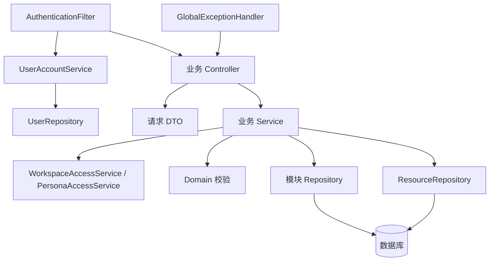

# Spring Boot 代码结构

当前开发入口：[实施总纲](PROJECT_BLUEPRINT.md) · [统一设计与交互](DESIGN_SYSTEM.md) · [2026-10-08 审查](PROJECT_REVIEW_2026-10-08.md)。

日期：2026-10-04。采用单应用、按业务模块组织、模块内分层的结构。Spring Boot 启动类仍在 `internal.distilly` 根包，统一扫描下层组件；保留 Java 17 编译目标、Spring JDBC、原有 HTTP 契约和数据库语义。

## 目录与职责

```text
server/src/main/java/internal/distilly/
├── Application.java
├── config/                       平台类型化配置及装配
├── security/
│   ├── AuthenticationFilter.java HTTP 认证、Worker 凭证、安全响应头
│   ├── service/                  账户配置、旧令牌撤销、令牌查询
│   └── repository/               账户持久化
├── web/
│   ├── exception/                统一异常处理
│   └── support/                  当前操作者及兼容输入校验
├── common/
│   ├── dto/                      复用的标题、版本及材料选择请求
│   ├── json/                     JSON 编解码
│   ├── persistence/              限定表名的资源读取、归属与事务行锁
│   ├── support/                  标识、时间、摘要
│   └── validation/               严格文本与模型结果校验
├── infrastructure/
│   └── migration/                V001～V005 追加式迁移执行
└── modules/
    ├── system/                   健康检查、登录验证、当前账户
    ├── workspace/                工作空间、成员、权限、审计和分页查询
    ├── material/                 材料上传、查询及读取授权
    ├── knowledge/                知识专题、版本、审核、人物读取配置与检索
    ├── persona/                  虚拟人设定、生命周期、版本与内容校验
    ├── personality/              独立人格资产及固定版本绑定
    ├── conversation/             私有交流、消息及记忆开关
    ├── memory/                   私有记忆的确认、纠正与删除
    ├── media/                    形象、语音、转写及媒体输入校验
    └── task/                     工作知识和虚拟人任务、租约及 Worker 接口
```

模块按需要包含 `controller`、`dto`、`service`、`domain`、`repository`。系统模块仅提供入口，无须为没有数据的功能创建空 Repository。

| 层 | 负责 | 约束 |
|---|---|---|
| Controller | HTTP 路由、文件解码、请求转换、返回类型 | 不写 SQL，不承载发布、绑定或租约规则 |
| DTO | 明确请求字段和严格类型校验 | 当前用显式 `from` 转换保留原来的 422 错误契约；不接受字符串代替布尔值或列表 |
| Service | 操作者权限、业务条件、流程编排、事务、结果装配 | 构造器注入；通过其他模块的 Service 协作，不调用其他 Controller |
| Domain | 人格、情感和媒体内容校验 | 不访问 HTTP 请求或数据库 |
| Repository | 具体 SQL、参数绑定、更新行数与查询结果 | 不判断当前账户角色，不决定审核与发布策略；不提交事务 |
| Config / Infrastructure | 类型化平台配置和迁移装配 | 不携带具体人物业务流程，不输出令牌或模型密钥 |

原有材料、知识、人物和任务接口使用数据库列名作为 JSON 字段，本次保持该契约。查询结果继续采用 JDBC 行映射；人格分析、模型输出和媒体任务的可变 JSON 由 `JsonCodec` 处理。稳定操作输入已拆出请求 DTO，避免在控制器反复解析相同字段。

## 请求与依赖方向



- `PersonalityService` 创建独立人格、验证来源与目标是否在同空间，并通过 `PersonaService` 返回人物详情。绑定复制已审核版本，保留来源人格和版本编号；历史交流仍使用原版本。
- `ConversationService` 负责私有交流和发送消息；`MemoryService` 修改记忆时取消当前用户仍在使用旧记忆的任务。
- `PersonaTaskService` 通过 `PersonaAccessService` 和 `PersonaKnowledgeService` 装配人物、最近消息、已确认记忆及知识来源，不反向依赖人物或交流的管理 Service。
- `WorkTaskService` 与 `PersonaTaskService` 分别保留两套任务契约；两种 Worker Controller 只负责 HTTP 适配，共享运行配置。
- `WorkspaceListService` 先验证角色，再调用 `WorkspaceListRepository` 搜索分页，最后通过任务 Service 装配可见内容。SQL 中的列名和筛选片段由服务端固定选择，搜索文本始终作为绑定参数。

## 事务与配置

事务仍放在 Service 的公开写入方法。创建工作空间及负责人、人格绑定及发布、消息及任务写入、记忆修改及取消在途任务、Worker 完成及派生内容写入保持原子性。行锁和带租约条件的更新仍在同一个 Spring 事务里执行；跨模块调用继承现有事务。

`PlatformProperties` 统一绑定 `platform.*`：演示模式、配置账户、Worker 凭证、模型模式、租约秒数及尝试上限。保留现有 `PLATFORM_*`、`MODEL_MODE` 环境变量。数据库、端口和文件大小仍由 Spring Boot 原生配置处理。

迁移执行器移到 `infrastructure/migration`；已应用的 SQL 文件、版本编号和数据表不修改，本次没有新增数据库迁移。认证失败继续返回 401；登录表单继续使用 200 响应中的 `error` 字段展示错误；业务异常继续返回原 HTTP 状态和 `{ "error": "错误码" }`。

## 后续开发放置方式

1. 确认功能归属，例如声音配置进入 `modules/media`，人格生成规则进入 `modules/persona/domain` 或人格业务 Service。
2. 新请求先定义模块 DTO；接口适配放 Controller，业务校验与事务放 Service，具体查询放 Repository。
3. 跨模块通过公开业务 Service 协作。共享权限、资源行锁、配置和编解码继续复用现有组件，避免复制另一套实现。
4. 表结构变化新增递增迁移，保留已经应用的文件。修改审核、任务、记忆和授权规则时补充相应业务回归。
5. Java 使用四空格缩进、构造器注入和明确方法返回类型；`.editorconfig` 与 `.springjavaformat` 记录格式规则。生成任务中的 Map 表示可变 JSON 数据，不能用它绕过内容校验。

测试专用 `PlatformFixture`、`PersonaFixture` 只在 `src/test` 组合多个新 Service，保留既有回归场景，不进入应用包或提供生产接口。

## 本次验证

- 75 条 HTTP 路由与重构前一致。
- `mvn -B -ntp -f server/pom.xml clean package`：48 个 Java 回归用例通过。
- Python Worker：14 个用例通过；3 组 Node 界面及登录会话回归通过。
- 原工作知识与虚拟人 HTTP 端到端使用临时文件数据库和测试网关，验证打包后的 API 与 Worker；不把协议测试视为真实媒体质量验收。

完整运行验证记录见 [虚拟人验收](PERSONA_VERIFICATION.md)。
