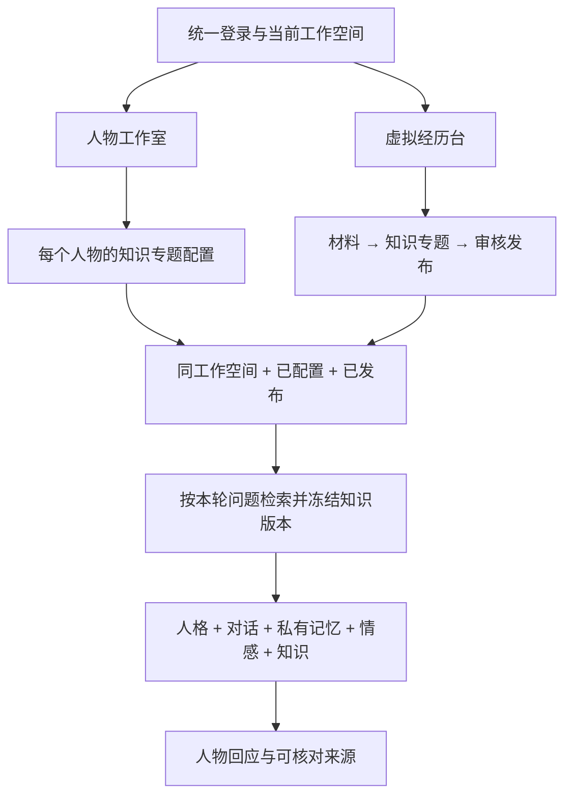

# 工作空间、虚拟经历台与人物知识架构

日期：2026-10-04。以下核心链路已实现；权限、检索、引用和共享登录有独立回归，真实模型效果与规模评测仍需持续验证。

## 产品命名

同一平台包含「人物工作室」和「虚拟经历台」，两者属于同一工作空间。
「经验主题」改称「知识专题」：按用途组织可复用知识，例如消息排障、客服沟通、接口评审。旧数据库profile、API profiles与历史ID保留，避免破坏既有材料和发布记录。
虚拟经历台管理材料、知识专题、候选、审核与发布；人物工作室管理人格、人物读取范围、交流与私有关系记忆。

## 结构

## 数据与权限

- 工作空间成员共享已发布知识。未发布候选及原材料沿用OWNER/EDITOR权限；VIEWER只能访问已发布知识。
- 人物通过persona_knowledge关联知识专题；默认不绑定，OWNER/EDITOR可选择最多20个同空间已发布专题，VIEWER只能使用和查看。
- 同空间人物可选择相同专题，也可有不同读取范围。客户端不能传任意知识正文给Worker；服务端查询绑定、空间、发布状态后装配。
- 知识配置是独立的实时设置，不改写人格版本。修改配置停止该人物所有用户的排队/在途回应；下一轮按新配置取知识。
- 个人对话、关系记忆、音频与转写仍按用户隔离，共享知识不包含其他用户的聊天与记忆。
- V004追加persona_knowledge、persona_job.knowledge_snapshot与persona_message.citations。旧数据保留，现有人物的读取范围初始为空。

## 检索和回答

1. Worker领取交流任务时，API核对用户的工作空间成员权限。
2. 查询人物已配置、未归档专题的当前APPROVED发布版本。
3. 英文/数字词与中文连续二字片段做文本匹配排序，最多取12条、16000字符。当前没有向量检索，关键词匹配可能漏掉同义表述，不能把无命中视为知识不存在。
4. 本轮知识快照包含专题ID、名称、发布版本、结论ID、章节和正文；不发送整份原始材料。
5. 模型用人物表达方式作答，工作空间事实需依本轮知识，不编造知识缺口，不将知识误当作人物亲身经历或私人记忆。
6. Worker与API均校验引用ID属于本轮快照；API再次检查绑定、工作空间、专题归档状态与版本批准状态后保存结果。不存在的引用拒绝整条结果。
7. 回复显示「知识来源」，可核对专题、章节、固定版本和已发布结论。下一轮读取新的当前发布版本，已有回答保留原来源。

专题归档后停止新的检索并拒绝尚未完成的旧来源结果；已保存的私人对话及来源快照是历史记录，修改授权不会自动清除，用户可删除交流。当前没有自动撤回历史内容或独立知识缓存。
知识接入用于运行时检索，并未重新训练基础模型，也不会自动把共享知识写入关系记忆或导出的Persona Skill。

## 模块切换

两个页面加载platform-session.js，共用同源、同标签页的platform-token与platform-workspace；兼容并迁移原persona-token/distilly-token。导航双向切换保留已登录身份和当前空间。
每次打开模块仍调用/auth/login验证令牌，再根据/api/projects成员列表恢复可访问空间。退出任一模块清除公共会话，账号变更清除旧空间选择；过期/无效令牌需重新登录。
不把令牌放入URL或跨域传递，不使用永久localStorage保存。不同浏览器或独立标签页仍需自己的会话；企业SSO与HttpOnly服务端会话是后续扩展。

## 接口与验证

GET /api/personas/{id}/knowledge查看专题可选项与绑定；PUT同路径传profile_ids更新。既有知识专题API继续使用/api/projects/{p}/profiles，不改旧请求契约。
PersonaTest覆盖空间隔离、人物不同配置、未发布/归档拒绝、快照和引用、授权撤销与迟到写回；Worker测试核对引用与人格约束；端到端验证材料→知识生成→发布→人物配置→交流引用→重启。
platform_session_test.cjs验证双向共享、工作空间保持、旧令牌迁移、账号切换和统一退出；浏览器实测模块切换与当前空间保持。

## 人格生成模块与绑定（V005）

虚拟经历台新增「人格生成」模块，与知识专题并列。人格作为独立资产：创建设定 → 选择多份授权材料 → Distilly两阶段分析/构建 → 候选编辑 → 负责人审核发布 → 绑定虚拟人。材料仍复用同工作空间的材料库，最多20份、合计60000字符；未选材料可按原创设定生成。

独立人格在persona表用library=TRUE区分，人物列表排除这些资产；生成任务与审核沿用已验证的人格流程。V005追加library和版本来源字段，不迁改历史人物版本。
绑定限同工作空间、已批准版本，由OWNER执行；一个人格可绑定多个虚拟人。绑定为虚拟人复制一份不可变的批准版本，保留源人格ID与版本ID，记录审计。形象、知识配置、用户关系记忆和聊天仍归虚拟人，未被复制。当前人物名称、身份与边界优先于复用模板的名称。已有交流继续使用原固定版本；新交流使用当前绑定。源人格后续更新不会自动影响已绑定人物，需显式重新绑定。

GET/POST /api/projects/{p}/personalities列出或创建独立人格；PUT /api/personas/{id}/personality接收personality_id和version_id。生成/编辑/审核沿用/api/personas/{id}下接口。历史人物人格保留可查看和回退，主要生成入口已移至虚拟经历台。

## 蒸馏流程复核与升级（2026-10-09）

上传直达生成、任务内新建专题、增量候选展示和边界重叠切分已实现。分块断点、逐条审核、混合召回等仍待实施；源代码发现、截图及验收计划见 [全流程复核与持续优化方案](KNOWLEDGE_DISTILLATION_REVIEW_2026-10-09.md)。
